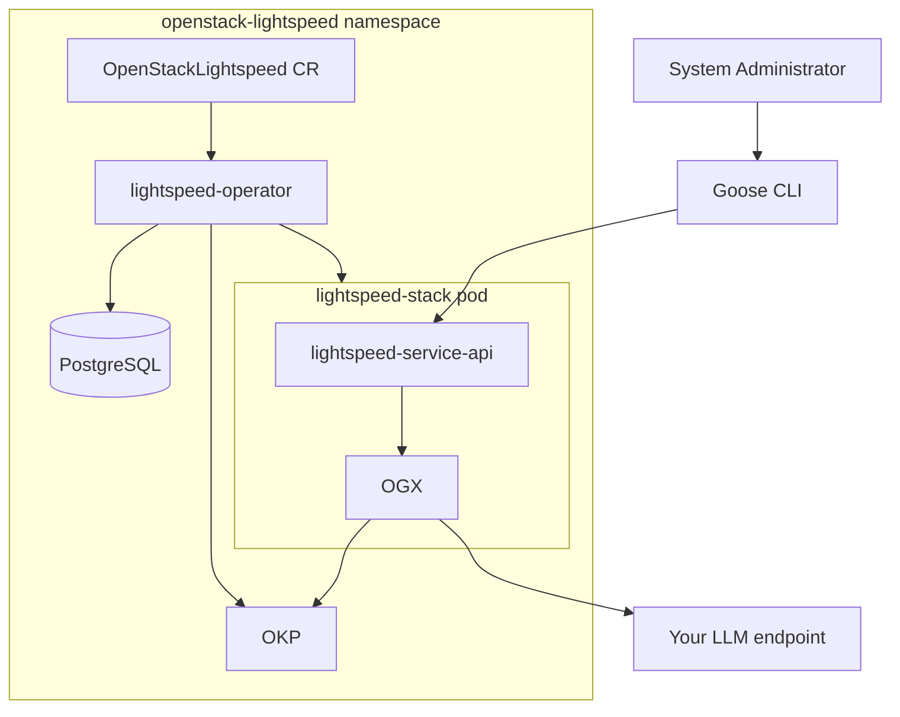

# Development

This page is for contributors and anyone testing changes locally — not
needed if you're just installing and using the operator.

## Local cluster with CRC

For local development/testing only (not for trying the assistant for real
— CRC is resource-constrained). Deploy a CRC cluster before
[installing the operator](install_guide.md#installing-the-operator):

```bash
git clone https://github.com/openstack-k8s-operators/install_yamls.git
cd install_yamls/devsetup
make download_tools

CRC_VERSION=2.51.0 PULL_SECRET=~/work/pull-secret CRC_MONITORING_ENABLED=true CPUS=12 MEMORY=25600 DISK=100 make crc
make crc_attach_default_interface
eval $(crc oc-env)
cd ../..
```

`PULL_SECRET` is the same pull secret described in the
[installation guide](install_guide.md#access-to-registry-images).

## Releasing to the community catalog

The **Propose community operator release** GitHub Actions workflow uses
already-published operator and bundle images from Quay. It resolves the selected
tag to image digests, extracts the bundle, and updates its version, community
metadata, and upgrade link to the preceding release. It runs bundle validation
and scorecard tests (in a temporary Kind cluster), then opens or updates a PR in
[community-operators-prod](https://github.com/redhat-openshift-ecosystem/community-operators-prod).
The current targets are the `alpha` channel on OpenShift 4.16, 4.18, 4.22 configured
in `.github/scripts/prepare_community_bundle.sh`.

Before the first release, a repository administrator must configure these
Actions secrets and variables:

- Secret `COMMUNITY_OPERATORS_TOKEN`: a bot account token that can push to the
  fork and create or update upstream PRs.
- Variable `COMMUNITY_OPERATORS_FORK`: the existing fork, in `owner/repository`
  format (for example, `openstack-lightspeed-bot/community-operators-prod`).
- Variables `RELEASE_AUTHOR_NAME` and `RELEASE_AUTHOR_EMAIL`: the bot's Git
  commit identity.

To make a release:

1. Wait for **Build and push operator container image** to finish successfully
   for the code you want to release.
2. In the `lightspeed-operator` repository, open **Actions → Propose community
   operator release → Run workflow**.
3. Set `new_version` to the next community version, such as `0.0.3` (without a
   `v` prefix). It must not already exist in the catalog. Set
   `container_image_tag` to `latest` (the default, from the latest main build),
   or a specific build tag such as `v0.1.0-<short-commit-sha>`.
4. Click **Run workflow**. If validation and scorecard pass, the run summary
   contains the upstream PR link. Follow that PR's checks and review through
   merge; the upstream pipeline handles publication to the catalog.

After publication, verify installation and a Lightspeed query on an OpenShift
cluster using the [installation guide](install_guide.md).

## Architecture



**OKP is deployed on every install, not opt-in.** It's the default RAG
source; the bundled community documentation is available too, but only if
you explicitly opt in. See [Configuration](configuration.md) for details.

## RHOKP container image

When it comes to the [Red Hat Offline Knowledge Portal (RHOKP or sometimes OKP) container image][rhokp-image],
and OpenStack Lightspeed, the following information might be relevant
for development:

- The [RHOKP container image][rhokp-image] has a time-based release with
  a weekly cadence. For more detailed information, consult the
  [RHOKP documentation][rhokp-docs].

- Only **the latest version** of the [RHOSO documentation][rhoso-docs] available at
  [docs.redhat.com][redhat-docs] during the [RHOKP container image][rhokp-image]
  build time is present in the container image.

- Only **the latest 7 versions** of the [OCP documentation][ocp-docs] available at
  [docs.redhat.com][redhat-docs] during the RHOKP container image build time
  are present in the container image.

## Pod security defaults

Operator-managed workloads are hardened by default with explicit
`securityContext` settings:

- `runAsNonRoot: true`
- `allowPrivilegeEscalation: false`
- `capabilities.drop: ["ALL"]`
- Pod-level `seccompProfile.type: RuntimeDefault` where supported

`readOnlyRootFilesystem: true` is enabled for most containers where
validated. Current intentional exceptions are:

- **OKP** container (runtime writes to image-managed paths)

If you change container startup behavior or image layout, re-validate
writable paths before enabling/disabling `readOnlyRootFilesystem`.

[rhokp-image]: https://catalog.redhat.com/en/software/containers/offline-knowledge-portal/rhokp-rhel9/680143c03b895f32bbd104c2
[rhokp-docs]: https://docs.redhat.com/en/documentation/red_hat_offline_knowledge_portal
[redhat-docs]: https://docs.redhat.com/en
[ocp-docs]: https://docs.redhat.com/en/documentation/openshift_container_platform
[rhoso-docs]: https://docs.redhat.com/en/documentation/red_hat_openstack_services_on_openshift
